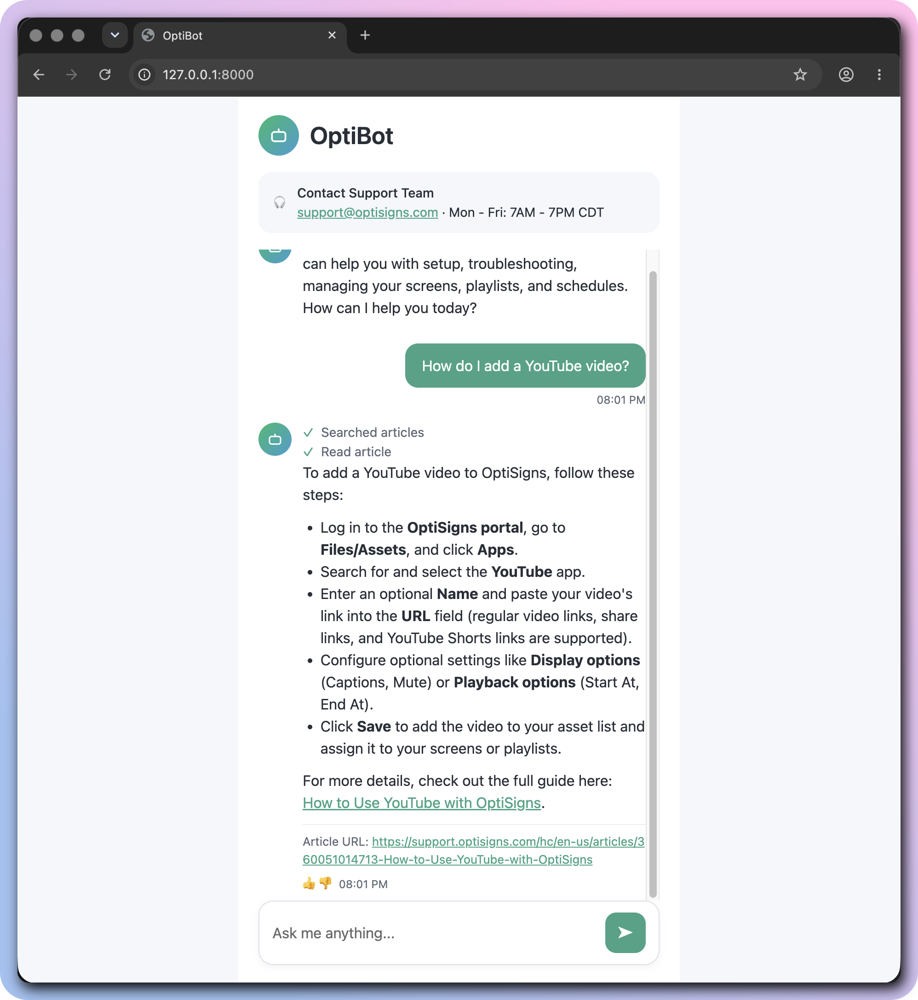

# Help-center → Gemini File Search sync (OptiBot mini-clone)

Scrapes the Zendesk help center, converts articles to Markdown, uploads only the delta to a Gemini File Search store. Runs once and exits 0.

## Setup
```
cp .env.sample .env   # set GEMINI_API_KEY (aistudio.google.com/apikey)
python -m venv .venv && .venv/bin/pip install -r requirements.txt
```

## Run locally
```
set -a; . ./.env; set +a
.venv/bin/pip install pytest && .venv/bin/python -m pytest -q   # unit tests (no network)
.venv/bin/python main.py              # scrape + sync
DRY_RUN=1 .venv/bin/python main.py    # scrape only, no Gemini calls
FILE_SEARCH_STORE=fileSearchStores/... .venv/bin/python ask.py "How do I add a YouTube video?"
docker build -t sync . && docker run --rm -e GEMINI_API_KEY=... sync
```

## How it works
- **Scrape**: `GET /api/v2/help_center/en-us/articles.json` (paginated, drafts skipped) → `markdownify` → `out/<id>-<slug>.md`. Each file starts with `# Title` + `Article URL: <html_url>` so the bot can cite it. Headings, code, tables, links preserved; only the article body is taken (no nav/ads).
- **Delta**: sha256 of the Markdown is stored in each document's `custom_metadata` (`article_id`, `hash`) → job is stateless. New id = added; changed hash = updated (new doc uploaded, then old deleted); same hash = skipped.
- **Chunking**: whitespace chunking, 500 tokens max / 50 overlap (API cap is 512 per chunk). Median article is ~6.7k chars (~1.7k tokens), so ~3-4 chunks keep each procedure section together; 50 overlap keeps a heading with its first step. Gemini exposes no chunk count; the log reports an estimate (~4 chars/token).
- **Log line**: `added=.. updated=.. skipped=.. files_embedded=.. est_chunks=..`

## Daily job
Docker on a VPS, cron `0 3 * * *` runs `run.sh` (docker run, append to log, push log to the `logs` branch with a repo-scoped deploy key).
Logs: https://github.com/Minhman23/ds-sync-x7q/blob/logs/sync.log (raw: https://raw.githubusercontent.com/Minhman23/ds-sync-x7q/logs/sync.log)
Each run prints `added/updated/skipped/failed`; a re-run with no changes gives `added=0 updated=0 skipped=414`.

## Sample answer

